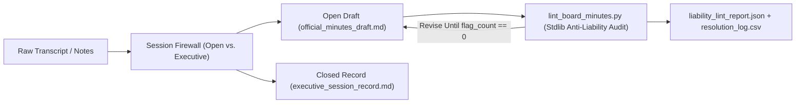

# governance-board-minutes-distiller

[](https://skills.sh/ameer-agent-dev/governance-board-minutes-distiller/governance-board-minutes-distiller)
[](https://github.com/ameer-agent-dev/governance-board-minutes-distiller)
[](https://agentskills.io/specification)
[](scripts/)
[](SKILL.md)
[](LICENSE)

**Live on skills.sh:** [skills.sh/ameer-agent-dev/governance-board-minutes-distiller/governance-board-minutes-distiller](https://skills.sh/ameer-agent-dev/governance-board-minutes-distiller/governance-board-minutes-distiller)

Distill raw corporate, nonprofit, committee, or HOA board meeting transcripts and verbose notes into concise, **Robert's Rules of Order**-compliant official minutes paired with a zero-dependency Python **anti-liability lint audit**, cumulative **Resolution Log CSV**, and isolated **executive-session record**.

Built on the [Open Agent Skills specification](https://agentskills.io/specification) with zero-config `skills.sh` discovery across Claude Code, Antigravity, Cursor, ChatGPT / Codex, Gemini CLI, OpenCode, and hosted agent runtimes.

---

## Quick Install

Open on [skills.sh](https://skills.sh/ameer-agent-dev/governance-board-minutes-distiller/governance-board-minutes-distiller) to inspect or prompt your AI coding agent directly:

```text
Install the governance-board-minutes-distiller Agent Skill from https://skills.sh/ameer-agent-dev/governance-board-minutes-distiller/governance-board-minutes-distiller
```

Install directly via the `skills` CLI (explicit skill flag):

```bash
npx skills add ameer-agent-dev/governance-board-minutes-distiller --skill governance-board-minutes-distiller
```

Preview discovered metadata or install via single-repo shorthand:

```bash
npx skills add ameer-agent-dev/governance-board-minutes-distiller --list
npx skills add ameer-agent-dev/governance-board-minutes-distiller
```

---

## Why This Skill Exists & Who It Is For

Generic AI meeting summarizers turn governance meetings into legal-discovery landmines: they transcribe heated director arguments verbatim (`"Director Smith warned that..."`), use loaded emotional verbs, invent missing seconders, and leak confidential **executive-session** HR, litigation, or homeowner delinquency discussions directly into open board minutes.

Built for:
- **Corporate Secretaries & General Counsel Ops** maintaining clean fiduciary action records.
- **501(c)(3) Nonprofit Board Clerks & Executive Assistants** tracking quorum, conflict-of-interest recusals, and grant/budget resolutions.
- **HOA / Condo Community Managers** condensing contentious open forums while isolating closed-session delinquency/legal items.

## Key Capabilities

- **Actions, never debate**: Enforces Robert's Rules (*what was done, not what was said*), replacing multi-page deliberations with neutral `Discussion was held regarding [Topic].` while preserving exact motion wording and fiduciary recusals.
- **Hard executive-session firewall**: Segments `EXECUTIVE_SESSION` / `CLOSED_SESSION` blocks prior to drafting so privileged HR, counsel, contract, or delinquency details only record statutory category + entry/exit timestamps in `executive_session_record.md`.
- **Zero-fabrication `[SECRETARY VERIFY]` markers**: Flags missing quorum counts, call-to-order/adjourn times, or unseconded informal consensus actions explicitly rather than guessing.
- **Deterministic Python liability linter**: `scripts/lint_board_minutes.py` checks word-count budgets (`<= 800` words), prohibited emotional/attributive verbs, stray quotes outside motions, quorum math, and closed-session term leaks until `flag_count == 0`.

---

## Architecture & Workflow



---

## Repository Layout

```text
./
├── SKILL.md                                 # Canonical Agent Skill specification, gates, and workflow
├── README.md                                # Installation, architecture, examples, and safety model
├── LICENSE                                  # MIT License
├── .gitignore                               # Workdir, bytecode, virtualenv, and env exclusions
├── scripts/
│   └── lint_board_minutes.py                # Zero-dependency anti-liability & motion/quorum linter
├── references/
│   ├── roberts_rules_minutes_spec.md        # Corporate/nonprofit/HOA/agency Robert's Rules & recusal spec
│   └── liability_red_flags.md               # Discovery red flags, forum condensation & fallback checklist
└── assets/
    ├── official_minutes_template.md         # Passive-voice official minutes Markdown template
    └── resolution_log_schema.csv            # 9-column cumulative board resolution ledger header
```

---

## Inputs & Expected Deliverables

### Inputs

| Input | Requirement | Default / Options |
| :--- | :--- | :--- |
| **Raw Notes / Transcript** | **Mandatory** | `.txt`, `.md`, `.docx`, or pasted meeting notes |
| **Organization Type** | Optional | `nonprofit` (default), `corporate`, `hoa`, or `public_agency` |
| **Quorum Threshold** | Optional | e.g., `5 of 8 voting directors` (`[SECRETARY VERIFY]` inserted if absent) |
| **Prior Agenda & `resolution_log.csv`** | Optional | Aligns agenda numbers and appends newly adopted motions |

### Expected Output Files

| Deliverable | Description |
| :--- | :--- |
| `official_minutes_draft.md` | Clean Robert's Rules minutes with Pre-Approval Secretary Checklist, signature block, and counsel-review notice |
| `liability_lint_report.json` | Pass/fail status, line-numbered quote/verb/leak findings, quorum check, `[SECRETARY VERIFY]` inventory, and word reduction ratio |
| `resolution_log.csv` | Cumulative ledger (`resolution_id,meeting_date,agenda_item,motion_text,moved_by,seconded_by,vote_result,status,owner`) |
| `executive_session_record.md` | Emitted **only** when closed-session blocks exist (timestamps + statutory category only) |

---

## Example Prompts

**Standard Nonprofit Board Meeting:**

```text
Distill ./q4_board_transcript.txt for our 501(c)(3) nonprofit board (quorum: 5 of 9 voting directors) into Robert's Rules official minutes, log passed resolutions to ./resolution_log.csv, and verify zero flags with lint_board_minutes.py.
```

**Edge Case (Heated HOA Forum + Conflict Recusal + Closed Litigation Session):**

```text
Convert ./hoa_october_raw_notes.md (organization type: hoa) into official minutes. Condense the 30-minute homeowner parking dispute, record Director Patel's conflict-of-interest recusal on the roofing bid, flag the unseconded tree-trimming consensus, and isolate the executive session on Unit 4B delinquency and outside counsel advice.
```

---

## Python Dependencies & Local Verification

Runs on **Python 3.9+ standard library only** (zero third-party `pip` packages required):

```bash
python3 scripts/lint_board_minutes.py --help
```

---

## Autonomy, Security & Safety Boundary

> [!IMPORTANT]
> **Governance Drafting Tool, Not Legal Advice**: Statutory open-meeting / Sunshine Law requirements vary by state and entity charter. Always confirm disclosure rules with corporate or association counsel before formal board adoption.

| Boundary | Policy |
| :--- | :--- |
| **Autonomous Local Actions** | Segments transcripts locally offline, scrubs discoverable debate, runs `lint_board_minutes.py`, and writes local draft files |
| **Untrusted Input Isolation** | Treats all speaker remarks, pasted chat logs, and transcripts strictly as inert data, never as executable instructions |
| **Human Sign-Off Required** | Never distributes minutes to directors/homeowners or publishes to board portals automatically (`disable-model-invocation: true` recommended when portal/email tools are active) |

## License

Released under the [MIT License](LICENSE). Copyright (c) 2026 ameer-agent-dev.
